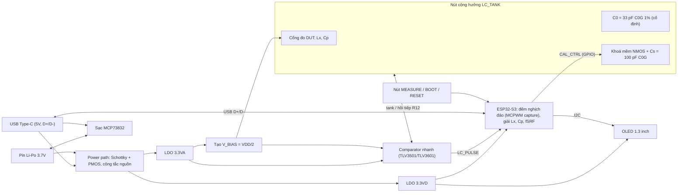

# Review phương án SRF/EPC Meter (Phương án 2 – ESP32-S3)

Tài liệu đã đọc: [LCR_Meter.kicad_sch](file:///home/manhquan/KiCAD_Projects/LCR_Meter/LCR_Meter.kicad_sch) (netlist xuất bằng `kicad-cli`), [BaoCao_SRF_EPC_Meter_PhuongAn2_ESP32S3.docx](file:///home/manhquan/KiCAD_Projects/LCR_Meter/BaoCao_SRF_EPC_Meter_PhuongAn2_ESP32S3.docx), [IEEE_2006_Inductor_EPC_Measurement_FredLee.pdf](file:///home/manhquan/KiCAD_Projects/LCR_Meter/IEEE_2006_Inductor_EPC_Measurement_FredLee.pdf), datasheet TLV3501, G6K, sơ đồ khối PNG.
Các con số tính toán bên dưới lấy từ script [error_budget.py](file:///home/manhquan/.gemini/antigravity-cli/brain/f49dcf6e-98da-4417-b754-2fcb8da60857/scratch/error_budget.py).

## 0. Kết luận nhanh

| Hạng mục | Đánh giá |
|---|---|
| Nguyên lý 2 tụ chuẩn (tách L và Cp) | **Đúng về toán**. Công thức và các ví dụ số trong báo cáo đều kiểm tra lại khớp (10 µH/42 pF → 7,77 MHz; hệ số khuếch đại sai số 231,6 pF). |
| Khả năng đạt Cp ±0,3 pF | **Chưa đủ cơ sở**. Có 3 nguồn sai số hệ thống chưa được xử lý đúng (mục 1.2–1.4). |
| Mạch dao động trong schematic | **Có lỗi phân cực DC** → nguy cơ chốt (latch), mất dao động với cuộn nhỏ/Q thấp (mục 2.1). Mạch cũng **khác** mạch mô tả trong báo cáo. |
| Bài báo IEEE 2006 | **Không phải bài về phương pháp đo**, mà về *khử* EPC. Không thể trích nó làm cơ sở cho phương pháp đo (mục 1.5). |
| Báo cáo ↔ schematic | **Lệch nhau rất nhiều** (MCU, LDO, giá trị tụ, GPIO, mạch phân cực, quy trình hiệu chuẩn) – mục 2.3. |
| Bảng kết quả thực nghiệm (Keysight E4980A) | Board chưa làm ra (mục ảnh vẫn để trống). **Phải bỏ hoặc ghi rõ là "dự kiến"**, nếu không sẽ bị coi là số liệu bịa. |
| Relay G6K → chuyển mạch mềm | Làm được, đề xuất **NMOS 2N7002/BSS138**, giảm 2 mã linh kiện (mục 3). |
| TLV3501 → "IC băm tần số" | Về vật lý, khâu tạo dao động **bắt buộc** phải có độ trễ ≤ ~5–7 ns ở dải 10 µH. IC chia tần không thay được vai trò này (mục 4). |
| Số mã linh kiện | 33 → **~23** (giữ pin) hoặc **~16** (chỉ cấp nguồn USB) – mục 5. |
| Sơ đồ khối | **Sai/thiếu** 7 điểm, có bản sửa ở mục 6. |

---

## 1. Kiểm tra lý thuyết

### 1.1 Phần đúng
Với C_A = C0 + Cp (C0 = C18 + Cstray + điện dung ký sinh của khoá ở trạng thái hở) và C_B = C_A + Cs:

- K = (f_A/f_B)² = C_B/C_A ⇒ **C_A = Cs/(K−1)**, **Cp = C_A − C0**, **Lx = 1/[(2πf_A)²·C_A]**, f_SRF = 1/(2π√(Lx·Cp)).
- Dải tần thực tế (C18 = 33 pF + Cstray 5 pF, Cs = 100 pF): 10 µH → 7,7 / 4,2 MHz; 100 mH → 77 / 42 kHz. ESP32-S3 đếm thoải mái.

### 1.2 Cp và C0 không thể tách ra bằng phép đo – chỉ tách được nhờ hiệu chuẩn
Về điện, Cp nằm **song song** với C18 + Cstray. Hai trạng thái chỉ cho ra **L và tổng C_A**. Vì vậy:

- Sai số của C0 đi thẳng vào Cp theo tỉ lệ **1:1** (C0 lệch 0,3 pF thì Cp lệch 0,3 pF).
- C18 trong schematic là **33 pF ±5 %** (±1,65 pF) chứ không phải ±1 % như báo cáo viết.
- Báo cáo mô tả *OPEN-cal dùng cuộn chuẩn nội L0 ≈ 100 µH* nhưng **schematic không có L0**. Còn *SHORT-cal* (chập 2 chấu đo) thì làm **tắt dao động** vì mất L, nên không thể đo được Llead theo cách đó.
- Muốn biết C0 thì cần một cuộn chuẩn đã biết Cp (đo bằng VNA của phòng lab), hoặc chấp nhận định nghĩa "Cp bao gồm điện dung của gá đo".

### 1.3 Sai số của tụ chuyển mạch Cs
C_A tỉ lệ thuận với Cs nên **Cs lệch 1 % ⇒ Cp lệch ≈ 0,43 pF, L lệch ≈ 1 %** (tính tại 100 µH). Muốn đạt ±0,3 pF thì Cs phải được hiệu chuẩn tới ~0,1 % bằng một tụ chuẩn ngoài:
đo ở 2 trạng thái → gắn thêm tụ chuẩn C_ref vào cổng đo → đo tiếp 2 trạng thái → giải ra Cs = C_ref / [1/(K′−1) − 1/(K−1)].

### 1.4 Bù tpd: sai số phụ thuộc Q nên không "khử sạch" được
Độ trễ vòng tạo ra góc pha φ = 2πf·tpd. Để bù góc này, khung LC phải làm việc lệch khỏi điểm cộng hưởng:
**f_osc ≈ f0·[1 − tan φ / (2·Q_loaded)]**.
Như vậy độ lệch tần phụ thuộc Q của DUT, mà firmware **không biết Q** (không có kênh đo biên độ). Công thức "hiệu chỉnh bậc nhất chỉ theo tpd" trong báo cáo là **chưa đủ**. Sai số Cp khi không bù (Cp thật = 5 pF, Q_L = 50):

| L | f_A / f_B | tpd 2,5 ns (TLV3601) | **4,5 ns (TLV3501)** | 7 ns (LMV7219) | 25 ns (2 cổng 74HC) |
|---|---|---|---|---|---|
| 10 µH | 7,68 / 4,21 MHz | +0,09 pF | **+0,17 pF** | +0,28 pF | **+3,1 pF** |
| 100 µH | 2,43 / 1,33 MHz | +0,05 pF | +0,08 pF | +0,13 pF | +0,51 pF |
| 10 mH | 243 / 133 kHz | +0,03 pF | +0,05 pF | +0,08 pF | +0,27 pF |

⇒ Bảng này cũng chính là **lý do vật lý để cần comparator nhanh** (xem mục 4).

### 1.5 Bài báo Wang – Lee – van Wyk (IEEE T-EMC 2006)
- Tên thật của bài: *"Inductor Winding Capacitance Cancellation Using Mutual Capacitance Concept for Noise Reduction Application"*. Bài này **khử** EPC; giá trị EPC được lấy bằng VNA E5070B quét 300 kHz–30 MHz. Tên file "EPC_Measurement" dễ gây hiểu nhầm. Báo cáo nên trích bài này để **định nghĩa mô hình (L ∥ EPC ∥ EPR, Fig. 1)** và **giải thích tầm quan trọng của EPC đối với bộ lọc EMI**, chứ không dùng làm cơ sở cho phương pháp đo.
- Điểm cần sửa: bài dùng mô hình **EPR song song**, còn báo cáo dùng **Rs nối tiếp**. Ở băng hẹp hai mô hình tương đương, nhưng nên nêu rõ.
- **Giới hạn phạm vi đo:** với cuộn ghép (choke CM), bài chỉ ra điện dung tương đương có thể **âm** (EPC < C_N/2, phương trình 11). Máy đo 1 đầu nối đất **không đo được** trường hợp này, nên phải ghi vào phạm vi đo: chỉ đo một cuộn dây, các cuộn còn lại để hở.
- Có thể dùng số liệu trong bài làm ca kiểm thử: L = 42,3 µH, EPC = 10,3 pF ⇒ SRF ≈ 7,6 MHz (bài báo ghi ~7,5 MHz). Với máy của bạn: f_A ≈ 3,5 MHz, f_B ≈ 2,0 MHz.
- "IEEE Std 389" có nội dung về SRF/điện dung phân bố, nhưng **chưa xác minh được** là có quy định riêng phương pháp "dao động 2 tụ chuyển mạch". Nên trích đúng điều khoản; nếu không có thì gọi là *phương pháp cộng hưởng hai tụ/hai tần số (Q-meter, Medhurst)*.

### 1.6 Các giả thiết và chỉ tiêu cần ghi rõ hoặc bỏ
- Phương pháp giả định **L không đổi giữa f_A và f_B** (f_A/f_B ≈ 1,8). Với lõi ferrite MnZn ở vùng MHz, µ′ thay đổi theo tần số nên sẽ có sai số hệ thống. Phải ghi vào giới hạn của phương pháp.
- "Chế độ đo L 0,1 µH" là không làm được: với 38 pF thì f = 81 MHz. "Đo tụ 1 pF–1 µF" cũng không làm được vì không có cuộn chuẩn nội. ⇒ **Bỏ** cả hai, hoặc thêm L_ref.
- Bảng thực nghiệm: E4980A chỉ đo tới 2 MHz nên không kiểm chứng được SRF 43 MHz. Mẫu 4,7 µH cũng nằm **ngoài** dải 10 µH mà báo cáo tự công bố.

---

## 2. Lỗi và điểm lệch trong schematic

### 2.1 Mạch dao động có vòng hồi tiếp dương DC → nguy cơ chốt
Netlist hiện tại: `OUT –R12 100k– IN+`, `IN+ –R14 100k– V_BIAS`, `IN+ –C17 10nF– TANK`, còn `IN− –R13– V_BIAS` + C16.

- Điện áp DC tại IN+ là (V_OUT,avg + V_BIAS)/2, còn IN− cố định ⇒ ở DC đây là **hồi tiếp dương** với hằng số thời gian (R12∥R14)·C17 = 0,5 ms.
- Phân tích duty cycle cho thấy điểm làm việc 50 % **mất ổn định khi biên độ tại IN+ là A < V_DD/(2π) ≈ 0,53 V**. Khi đó comparator chốt ở một mức và dao động tắt.
- Ví dụ: 10 µH, Q = 30 cho A ≈ 0,24 V ⇒ **chốt**; 100 µH, Q = 50 cho A ≈ 0,63 V ⇒ sát biên. Như vậy nửa dưới của dải đo có nguy cơ không dao động.
- Báo cáo có mô tả vòng *auto-zero (OUT → 100k → IN−, 10 µF)*, nhưng **schematic không có vòng này**.

**Cách sửa (chọn 1):**
- **A – sửa tối thiểu:** mắc nối tiếp 1 tụ **10 nF** (cùng mã với C17) với R12. Khi đó DC tại IN+ = V_BIAS, hết hồi tiếp dương DC.
- **B – nên làm:** nối **đầu lạnh của DUT vào V_BIAS** (đã decoupling 4,7 µF ∥ 100 nF) thay vì GND, rồi bỏ C17. Cuộn cảm sẽ ghim DC của IN+ đúng bằng V_BIAS (R_DC của DUT ≪ R12), đồng thời bỏ được R13/C16 vì có thể nối IN− thẳng vào V_BIAS. Giữ R14 để giới hạn biên độ ≤ ~1 V. Lưu ý: vỏ SMA không được nối GND nữa, nên **thay SMA bằng 2 pad/kẹp Kelvin** (cắm cuộn cảm vào SMA vốn cũng bất tiện).
- Cách nào cũng phải **mô phỏng SPICE** (model TLV3501 của TI) ở các góc: 10 µH/Q = 20 → 100 mH/Q = 100.

### 2.2 Phần còn lại của schematic
- Sơ đồ chân TLV3501 (SOT-23-6: 1 = −IN, 2 = V−, 3 = +IN, 4 = V+, 5 = OUT, 6 = SHDN) → **đúng**. SHDN nối GND nghĩa là luôn bật → đúng.
- Power path (D2 1N5819 + Q1 AO3401 có gate nối VBUS + R15 kéo xuống) → **đúng**. MCP73832 với R11 = 2 kΩ cho dòng sạc 500 mA → đúng. CC 5,1 kΩ → đúng.
- C10 và C16 cùng là 10 µF 0805 nhưng là **2 mã khác nhau** → gộp lại.
- K2 G6K: chân 3 = TANK, 4 = C12, 1/8 = cuộn hút. Chân trong symbol chưa được đặt tên nên cần đối chiếu sơ đồ chân trong datasheet (không cần nữa nếu bỏ relay).

### 2.3 Báo cáo ↔ schematic lệch nhau

| Mục | Báo cáo | Schematic |
|---|---|---|
| MCU | ESP32-S3-MINI-1U (8 MB) | **ESP32-S3-WROOM-1U-N4R2** |
| LDO | RT9193-33GB (U3 = D, U5 = A) | **AP2112K-3.3** (U1 = 3.3VD, U3 = 3.3VA) |
| Tụ chuẩn | khi C1 = 33 / C2 = 100 chuyển mạch, khi Ccal = 1000 pF | C18 = 33 pF **cố định** + C12 = **100 pF** chuyển mạch |
| GPIO relay / nút | GPIO16/17, GPIO12 / GPIO10 | **IO13 / IO9** |
| Cuộn hút relay | có chỗ ghi 5 V, có chỗ 3 V | 3 V, cấp từ 3.3VD |
| Phân cực comparator | auto-zero từ OUT | IN− lấy từ V_BIAS tĩnh + ghép AC qua C17 |
| Hiệu chuẩn | L0 nội, OPEN/SHORT | không có L0 |
| Nguồn | MCP73832 cấp thẳng cho LDO | load-sharing D2/Q1 + SW4 |

---

## 3. Chuyển mạch mềm thay relay G6K

Nói công bằng: **về điện, relay vẫn là khoá tốt nhất** (C_off ~0,3–0,5 pF, R_on ~50 mΩ, tuyến tính). Điểm yếu của nó là cuộn hút ~34 mA, phải chờ nảy tiếp điểm (ms), tuổi thọ cơ khí, cồng kềnh, khó mua mã 3 V ở VN, và thêm 3 linh kiện kích. Chuyển mạch mềm khắc phục được những điểm này, đổi lại phải trả giá ở **C_off và R_on**.

Đánh giá ảnh hưởng của R_on nối tiếp với Cs = 100 pF (ở trạng thái B):

| Phương án | R_on | C ký sinh khi OFF | ΔC_eff @10 µH (4,2 MHz) | Ghi chú | Mua ở VN |
|---|---|---|---|---|---|
| Relay G6K (hiện tại) | 0,05 Ω | ~0,5 pF | 0 | 34 mA, cần SS8050 + diode + R | khó, đắt |
| **NMOS 2N7002 / BSS138 hạ áp** | 3–6 Ω | C_oss ~10–15 pF nối tiếp Cs → ~10–13 pF | −0,01 % | đóng/cắt µs, 0 mA | **rất sẵn, ~500 đ** |
| Analog switch 74LVC1G66 / TS5A3166 | 1–15 Ω | 5–10 pF + C chân | ~−0,01…−0,05 % | tín hiệu phải nằm trong 0…VDD | đặt online |
| Diode 1N4148W (kiểu PIN) | ~6 Ω @5 mA | ~1 pF | −0,03 % | **mạng phân cực xung đột với dải 40 kHz** (cần RF choke) | sẵn |
| GPIO ESP32 trực tiếp | ~40 Ω | ~5 pF + ESD | **−1,1 %** ✗ | quá lớn | – |

**Đề xuất: 2N7002 (hoặc BSS138) mắc phía thấp.**

```
TANK ──┬── C18 33pF C0G 1% ── GND
       └── Cs 100pF C0G 1% ──┬── D  Q (2N7002)   S ── GND
                             │       G ── 470Ω ── GPIO13
                 3.3VA ── 1MΩ┘   (phân cực DC cho drain)
```

- **1 MΩ** giữ drain ở +3,3 V DC khi OFF, để diode thân không dẫn khi tank dao động âm và C_oss nhỏ, ổn định. Không dùng 100 kΩ: ở 42 kHz thì X_C(C_oss) ≈ 250 kΩ, nên 100 kΩ sẽ biến nhánh Cs thành mạch RC tổn hao.
- Điện dung C_oss (dù đóng hay hở) được gộp vào **C0 và ΔC**, rồi hiệu chuẩn như mục 1.3. Trôi ước tính (theo nhiệt độ, VDD, biên độ) khoảng 0,05–0,1 pF, vẫn nằm trong ngân sách ±0,3 pF.
- Bỏ được: K2, Q4 SS8050, D1 1N4148W, R4 4,7 kΩ. Thêm: 2N7002, 1 MΩ ⇒ **giảm 2 mã**, và bỏ được cả 2×25 ms chờ relay.

---

## 4. TLV3501 và "IC băm tần số"

Bảng ở mục 1.4 là ràng buộc vật lý: Cp đo được chính xác đến đâu phụ thuộc C0 nhỏ đến đâu. C0 nhỏ thì f_A cao (10 µH, 38 pF → 7,7 MHz), mà f_A cao thì **độ trễ vòng phải ≤ ~5–7 ns**. IC chia tần đặt **sau** bộ dao động thì không thay được khâu khuếch đại/so sánh **trong** vòng dao động.

| Cách hiểu "IC băm tần số" | Ví dụ (sẵn ở VN) | Có thay TLV3501 được không |
|---|---|---|
| IC chia tần / prescaler | 74HC4040, 74HC393, 74LVC1G74 | **Không cần**: PCNT/MCPWM của ESP32-S3 đếm được tới ~40 MHz. Chỉ thêm mã linh kiện. |
| IC băm xung PWM | 555, TL494, SG3525 | **Không**: trễ cỡ 100 ns–µs. |
| Dao động + chia tần tích hợp | 74HC4060 (Pierce LC), 74HC4046 (PLL, ngõ vào SIG_IN tự phân cực) | Dùng được cho một **máy đo L đơn giản** (L ≥ ~100 µH). Với EPC thì sai: DUT phải nổi, bị kích rail-to-rail, trễ 15–25 ns ⇒ sai số Cp > 0,5 pF. |
| IC tổng hợp tần số để quét | Si5351A / MS5351M (có module ở VN) | Đổi hẳn sang **kiến trúc quét trở kháng** giống VNA trong bài báo: đo **trực tiếp SRF** tới > 30 MHz. Nhưng cần thêm detector + ADC, phải xử lý hài của sóng vuông, độ phân giải đỉnh kém hơn đếm tần, và **nhiều mã hơn**. Hợp làm *chế độ kiểm chứng*. |

Comparator ≤ 7 ns thì **không có cái nào bán sẵn ở chợ linh kiện VN** (đã tìm: TLV3501 chỉ có trên Shopee hàng quốc tế, ~110–150k đ). Hướng thực tế:
1. **Giữ comparator nhanh**, đặt trên LCSC cùng đơn PCB: **TLV3601** (2,5 ns, rẻ hơn TLV3501) hoặc giữ TLV3501.
2. Nếu bắt buộc mua trong nước: nâng **Lmin lên ~1 mH** rồi dùng 74HC4046/74HC4060, và hạ chỉ tiêu Cp.

ESP32: chỉ cần **MCPWM capture với prescaler** (chốt timestamp 80 MHz mỗi N cạnh) là đủ để đếm nghịch đảo, không cần ghép PCNT.

---

## 5. Gộp mã linh kiện (33 → ~23)

| Nhóm | Hiện tại | Đề xuất |
|---|---|---|
| Tụ | 1 µF, 2,2 µF, 4,7 µF, 10 µF ×2 mã, 100 nF, 10 nF, 33 pF, 100 pF (9) | **4,7 µF, 100 nF, 33 pF C0G 1 %, 100 pF C0G 1 %** (4). Có thể thêm 10 nF nếu sửa theo cách A ở mục 2.1. |
| Điện trở | 100k, 10k, 5,1k, 4,7k, 2k, 470, 100, 22 (8) | **100k, 10k, 5,1k, 2k, 470, 1M** (6): R15 → 10k; R2 100 Ω → 470 Ω (với C_in ~5 pF thì τ = 2,3 ns, vẫn ổn ở 8 MHz); R5/R6 22 Ω để tuỳ chọn hoặc 0 Ω. |
| Bán dẫn | 1N4148W, 1N5819, LED, AO3401A, SS8050, G6K, AP2112K, TLV3501, MCP73832, ESP32 (10) | bỏ SS8050, G6K, 1N4148W; thêm 2N7002 ⇒ **8** |
| Cơ khí | OLED, USB-C, nút, công tắc gạt, pad pin, SMA (6) | SMA → pad/kẹp 2 chân ⇒ 6 |
| **Tổng** | **33** | **~24** (giữ pin) / **~17** (chỉ dùng USB: bỏ MCP73832, AO3401A, 1N5819, LED, 2k, công tắc gạt, pad pin) |

---

## 6. Sơ đồ khối

**Lỗi trong [SoDoKhoi_SRF_EPC_Meter_ESP32S3.png](file:///home/manhquan/KiCAD_Projects/LCR_Meter/SoDoKhoi_SRF_EPC_Meter_ESP32S3.png):**
1. Không khớp schematic: ghi MINI-1U, RT9193, Ccal = 1000 pF, GPIO10.
2. Thiếu khối **power path** (D2/Q1 + SW4). Hình vẽ MCP73832 cấp thẳng cho LDO là sai, vì MCP73832 không có power path.
3. **GND được vẽ như mũi tên tín hiệu** đi vào 3 khối. GND là mức tham chiếu, không phải luồng tín hiệu.
4. Các khối tụ nền → relay → dao động được vẽ thành **chuỗi nối tiếp**. Thực tế chúng là **một nút cộng hưởng chung** (DUT ∥ C0 ∥ khoá + Cs), và giữa nút này với comparator là **vòng hồi tiếp 2 chiều**.
5. Thiếu khối **V_BIAS**, mà nó cấp cho cả comparator lẫn (theo cách B) đầu lạnh của DUT.
6. Có chi tiết layout không thuộc sơ đồ khối (độ rộng mạch 0,8 mm, skew 0,025 mm, giá trị R).
7. Chữ đè lên nhau ("IC Sạc… BAT (Star-Routing)", "Chân 3.3VA").

**Đề xuất (theo phương án sửa):**



---

## 7. Cần bạn xác nhận
1. Anh khoá trên nói **"IC băm tần số"** là ý nào: prescaler/chia tần, PLL 74HC4046, hay IC tổng hợp tần số kiểu Si5351 (quét)? Mỗi ý dẫn tới một kiến trúc khác nhau (mục 4).
2. Có **bắt buộc** mọi linh kiện mua được ở chợ VN không, hay được đặt LCSC kèm đơn PCB? Câu trả lời quyết định giữ comparator hay phải hạ Lmin.
3. Có cần **pin Li-Po** không? Bỏ pin thì giảm thêm 7 mã.
4. Sửa mạch dao động theo **cách A** (thêm 1 tụ, giữ SMA/GND) hay **cách B** (DUT nối V_BIAS, gọn hơn, phải đổi đầu nối)?
